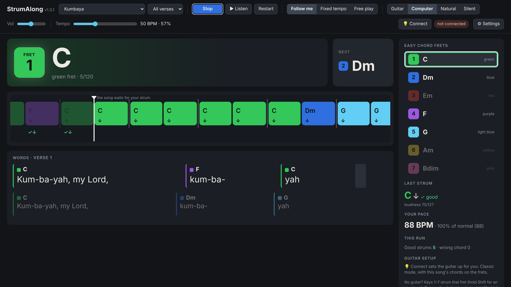

# StrumAlong

**Version 1.12.0** (November 2026) · see `CHANGELOG.md`

*Unofficial project, free and as-is: use at your own risk. See the [Disclaimer](#disclaimer) at the bottom.*

> **🥁 New in 1.12: no more tapping.** The Listener now finds the beat of a song by itself when it makes a Rock Out song, even on records that speed up and slow down. Tapping is still there if you want it.
>
> **🎸 New in 1.11: three more Rock Out songs.** Play along with **Let It Be** (The Beatles), **Against the Wind** (Bob Seger, with the words on screen in his official lyric video) and **You Belong With Me** (Taylor Swift), straight from the artists' own YouTube uploads.
>
> **🎤 New in 1.10: StrumAlong is now for everyone.** No AeroBand? No problem. Press **🎤 Any instrument** and play a real guitar, keyboard, ukulele or piano: StrumAlong listens through your computer's microphone, hears the chords you play and moves the song along. *Experimental: tell us how it works for you.*

**StrumAlong is a free play-along app for anyone learning guitar or keyboard, and for players who want to practise along with the music they love.** It started life as a companion for the **AeroBand smart guitar** (also called the Aero Guitar), and everything it does for the AeroBand is still here. Now it works with any guitar, keyboard or ukulele too (🎤 Any instrument, experimental), and with **🎸 Rock Out** you can play along with the real record on YouTube.

It gets you playing real songs from your very first strum. It shows the chords and words big on your computer screen, lights the AeroBand's fret for each chord, and **waits for you**: in Follow me, the song only moves on when you play the chord, so you learn at your own pace. Already play? It works for you too. Runs free in Google Chrome on a Mac or Windows computer.

- No install, no drivers, no AeroBand phone app needed.
- Works with the guitar over Bluetooth, straight from the browser.
- **🎤 Any instrument (new in 1.10, experimental):** play a regular guitar, keyboard, ukulele or piano near your computer. StrumAlong hears each chord through the microphone (nothing is recorded), so Follow me, Fixed tempo and Free play work without an AeroBand. Click the button again to switch it off. Best with headphones for the band and click, so it hears only you. Play chords, not single notes.
- Bring your own songs: drop a chord sheet (text or ChordPro) on the window.
- **Jam with the band (new in 1.6):** drums and bass play along behind your strums (Folk, Country or Rock; each song picks a style), with a **Band** slider to mix them in.
- **🎸 Rock Out:** play along with the real record. Pick **Summer of '69**, **Sweet Home Alabama**, **Let It Be**, **Against the Wind** or **You Belong With Me** and the artist's official video plays inside StrumAlong while the frets light up in time with it. The Tempo slider slows the video down (0.75× or 0.5×) for practice. Works with ▶ Listen and Fixed tempo; needs an internet connection. How Rock Out respects artists' rights is explained in plain English [at the end of this page](#rock-out-rights-and-permissions-in-plain-english).
- **🎧 Make your own Rock Out songs (new in 1.9):** the StrumAlong Listener hears a YouTube song through your computer's microphone and writes down its chords. It finds the beat by itself (new in 1.12; you can still tap it), then you check the chart, click to fix any chord, and add it to your song list. Nothing is ever recorded: a song keeps only chord names and their timing. Song menu → 🎧 Make a Rock Out song…
- **Hear it sung:** the traditional songs (Kumbaya, Clementine, Oh! Susanna, Yankee Doodle and I've Been Working on the Railroad) come with a sung vocal (an AI singer) that sings along with the chords in Listen and Fixed tempo, so you can hear how the words fit the strums. A **Voice** slider sets the singer against the guitar.

**Guides:** `docs/StrumAlong-Quick-Start.pdf` (first use, 2 pages), `docs/StrumAlong-User-Guide.pdf` (how to play) `docs/StrumAlong-Rock-Out-Guide.pdf` (play along with YouTube and make your own songs, 2 pages) and `docs/StrumAlong-Technical-Guide.pdf` (how it works, how to change it).

## Quick start

1. Use an **up-to-date Google Chrome** on a Mac or Windows computer with Bluetooth (in Chrome: menu → Help → About Google Chrome updates it). StrumAlong was built and tested in Chrome. Microsoft **Edge** uses the same engine and should work, but is untested. (Safari and Firefox can't talk to Bluetooth devices.) **Not iPhone or iPad**, in any browser: Apple's browser engine can't reach Bluetooth devices. **Android** tablets with Chrome: untested.
2. Open the app:
   - **Just use it (most people):** the app is hosted online by GitHub and runs in Chrome. Nothing to install. **[Open StrumAlong →](https://strumalong9779.github.io/StrumAlong/)**
   - **Want the source code, or to run it on your own computer?** Download the full package (`StrumAlong-x.y.z.zip`) from the **[latest release](https://github.com/strumalong9779/StrumAlong/releases/latest)** and unzip it. Then on a Mac double-click `Start StrumAlong (Mac).command` (the first time, right-click it and choose Open); on Windows double-click `Start StrumAlong (Windows).bat` (needs Python from python.org). These start a small local server, because browsers only allow Bluetooth on `https://` or `http://localhost` pages; just double-clicking `index.html` won't work.
3. Turn the guitar on, close the AeroBand phone app, click **💡 Connect**, pick the guitar in the list.
   - ⚠️ **Don't pair the guitar in your computer's Bluetooth settings.** Connect only with StrumAlong's **💡 Connect** button: Chrome has its own Bluetooth link to the guitar, separate from your Mac's or PC's Bluetooth menu, and the **Pair** button in Chrome's pop-up list is the right one. If System Settings → Bluetooth (Mac) or Settings → Bluetooth & devices (Windows) shows the guitar as **connected**, **disconnect** it there first. No need to remove or forget it.
4. Choose a song, press **Start**, strum.
5. **Done?** Click **💡 Connected** (or Settings → ↺ Chord reset & disconnect) to put the guitar back the way it came.

**Sound:** normally the sound comes out of the **computer**, not the guitar: choose **Computer** (a clean strum of the chord you meant) or **Natural** (exactly what you play), and turn the guitar's volume knob down. **Guitar** uses the guitar's own speaker; **Silent** plays nothing. The user guide explains each one.

**Strum style:** with Computer sound, pick **Fingerpick**, **Boom-chuck** or **Arpeggio** in Settings: you strum once per block and the computer plays the pattern. Strum up instead of down for a bass walk into the next chord.

**Privacy:** no accounts, no cookies. The hosted site keeps an anonymous visit count (GoatCounter) so we know whether anyone uses it; nothing you play is sent anywhere, and copies run from your own computer aren't counted.

## Credits

- Written with **Claude Opus 5.5** (Anthropic's AI), at the direction of, and tested by, the project's author, Greg.
- Guitar and bass sounds: FluidR3_GM soundfont by Frank Wen, CC BY 3.0, served by gleitz/midi-js-soundfonts. Drums are synthesized in the browser.
- **Rock Out** songs play the artist's own official video through YouTube's standard player; StrumAlong stores only the chord names and their timing, worked out by ear. No recording is copied or hosted here.
- Built-in songs are traditional, public-domain tunes.
- The song vocals are sung by **TIGER DS**, a free AI singing voice by tigermeat (licence CC BY-NC-ND 4.0 with Commons Clause: free for non-commercial use), rendered with **OpenUtau** (free, MIT licence). The vocal recordings (`songs/vocals/*.mp3`) are not covered by StrumAlong's MIT licence: share them only non-commercially, with this credit.

**Privacy:** StrumAlong keeps your settings in your own browser and never records sound. Details: [Privacy & Terms](PRIVACY.md).

## Not affiliated

StrumAlong is an independent project. It is not made by, endorsed by or affiliated with AeroBand
or Anthropic. "AeroBand" is a trademark of its owner. The app talks to the guitar using commands
observed from the guitar's own Bluetooth traffic, for interoperability; use at your own risk.

## Why it exists, and contributing

StrumAlong is a project to help more people make music, for the good of all. Our only hope is that you find it useful.

It began with the AeroBand guitar, which we think is a great product. StrumAlong is meant to enhance it, not compete with it: a big-screen way to
learn and play that we hope brings more people to the guitar, and now to the keyboard and every other instrument too.

Contributions are welcome: open an **Issue** for bugs and ideas, or send a **pull request** with fixes, features or
public-domain songs. For guitar commands, only use ones seen from the official app, and test one change at a time.

**Hear a wrong chord in a Rock Out song?** The charts are worked out by ear, so tell us: open an Issue with the song, the time in the video and what you hear (for example "Let It Be, 1:12, that should be F"), and we'll fix it.

Thank you, and keep playing!  
— Greg

License: MIT (see `LICENSE`).

## Disclaimer

> StrumAlong is an independent, unofficial project. It is not made, endorsed, supported or approved by AeroBand or Anthropic.
> It is provided free and "as is", without warranty of any kind. It does not change the guitar's firmware, but it does change guitar settings
> (mode, lights, Easy Chord layout). **Use it entirely at your own risk**; the authors accept no liability for any damage, malfunction,
> voided warranty or other problem. These settings stay on the guitar after it is switched off; StrumAlong's **Chord reset** button (or the official AeroBand app) puts them back. "AeroBand" is a trademark of its owner,
> used only to say which guitar this works with. Rock Out and the Listener use YouTube API Services (YouTube's embedded player): by using them you also agree to the
> [YouTube Terms of Service](https://www.youtube.com/t/terms); see [Privacy & Terms](PRIVACY.md) and the [Google Privacy Policy](https://policies.google.com/privacy).
> **By using StrumAlong, you agree to these terms.** If you don't agree, don't use it.

## Rock Out: rights and permissions, in plain English

Rock Out lets you play along with famous songs, and it was built to respect the people who made them. Here is exactly what it does, and what it doesn't.

1. **The music is the artist's own upload, played the normal way.** Rock Out plays the official video or audio that the artist or their label posted on YouTube, through YouTube's standard embedded player, exactly as posted. Nothing is downloaded, copied, cut, edited, remixed or re-uploaded. Plays count as views and can show ads as usual, so the artist still gets the view. We only use uploads whose owners allow them to be embedded, and we follow the [YouTube Terms of Service](https://www.youtube.com/t/terms). If an owner turns embedding off, the song simply stops playing here.
2. **We don't publish song lyrics.** StrumAlong never includes the words to the Rock Out songs. Where you do see words, they are part of the artist's own lyric video. (The built-in folk songs are in the public domain, so their words are free to use.)
3. **Chords are free for everyone.** A Rock Out song file holds only chord names and when they change, for example "C, then G two beats later". No melody, tab, sheet music, recording or snippet of audio. Chord progressions are the shared building blocks of music: in the Ed Sheeran "Thinking Out Loud" case (*Structured Asset Sales v. Sheeran*, 2024), the US Court of Appeals for the Second Circuit held that chord progressions and harmonic rhythm are not protected by copyright, and the Supreme Court declined to review it.
4. **The Listener listens; it doesn't record.** When you make your own Rock Out song, the Listener hears the song through your microphone, keeps only a summary of which notes it hears, and saves only chord names and their timing. No sound is ever recorded, saved or uploaded.
5. **Names are used only to say which song it is.** Song titles and artist names identify the song. StrumAlong is not affiliated with or endorsed by any artist, label, publisher or by YouTube.
6. **Own a song and want it changed or removed?** Open an Issue on GitHub, or send a notice through [GitHub's own copyright process](https://docs.github.com/en/site-policy/content-removal-policies/dmca-takedown-policy).

## Visits

*Total visits to the hosted app ([strumalong9779.github.io/StrumAlong](https://strumalong9779.github.io/StrumAlong/)), counted anonymously by GoatCounter; updates every few hours.*
